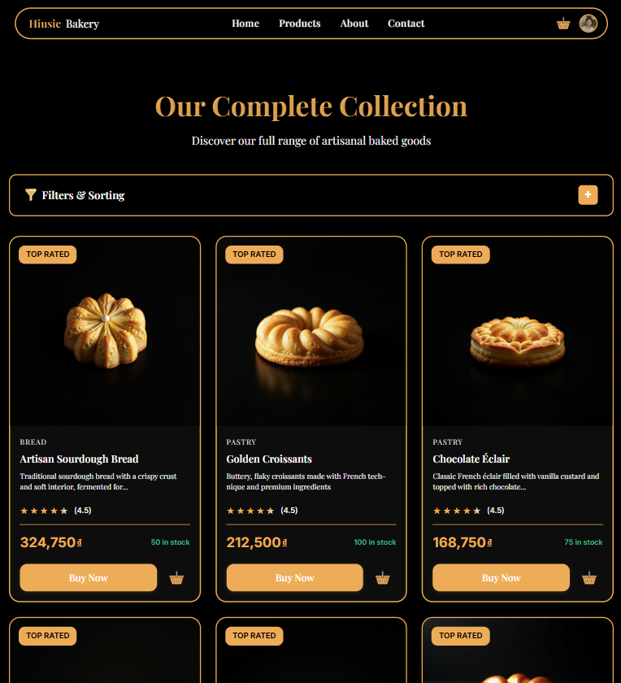
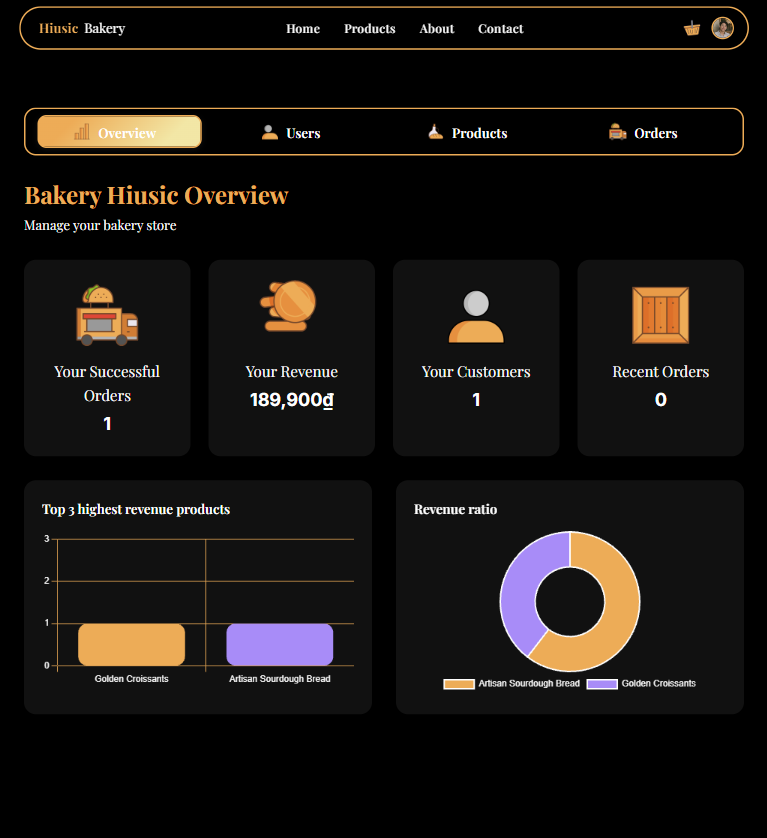

# Bakery Hiusic

Bakery Hiusic is a full-stack bakery storefront and administration platform. Customers can browse and filter products, manage a cart, place orders, review products, and manage their accounts. Administrators get a protected dashboard for monitoring the store and managing products, orders, and users.

## Application preview

### Home

The storefront introduces the bakery, highlights featured products, and gives customers quick access to the catalog.


### Products

Customers can explore the catalog, search and filter products, view product details and reviews, and add items to their cart.



### Administration

The role-protected administration area provides store statistics and tools for managing users, products, and orders.



## Features

- Responsive bakery storefront built with Angular and Angular Material
- Product browsing, search, categories, tags, filters, ratings, and reviews
- Shopping cart, checkout, order history, and order management
- Registration, sign-in, JWT authentication, password reset, and account management
- Role- and permission-based access control
- Admin dashboards for users, products, orders, customers, and revenue
- REST API documentation through Swagger UI
- Database migrations and sample data managed by Liquibase
- Redis-backed product caching
- Docker Compose setup for the complete application

## Architecture

| Component | Technology | Default URL |
| --- | --- | --- |
| `bakery-hiusic-ui` | Angular 17, Angular Material, Chart.js | http://localhost |
| `auth-hiusic-service` | Java 17, Spring Boot 3, Spring Security, JWT | http://localhost:7777 |
| `product-hiusic-service` | Java 17, Spring Boot 3, Spring Data JPA | http://localhost:8888 |
| SQL Server | Microsoft SQL Server 2019 | `localhost:1433` |
| Redis | Redis 7 | `localhost:6379` |

The frontend communicates with the two REST services. The authentication service owns users, roles, permissions, and tokens. The product service owns the catalog, reviews, carts, and orders, and asks the authentication service to validate users and permissions.

## Run with Docker

### Prerequisites

- Docker Desktop with Docker Compose
- At least 4 GB of memory available to Docker
- Ports `80`, `1433`, `6379`, `7777`, and `8888` available

### 1. Configure the environment

Create `docker-hiusic-script/.env` and provide values appropriate for local development:

```env
DB_HOST=sqlserver
DB_AUTH_NAME=auth-hiusic-service
DB_PRODUCT_NAME=product-hiusic-service
DB_USERNAME=sa
DB_PASSWORD=YourStrongPassword123!
SPRING_PROFILES_ACTIVE=default
JWT_SECRET_KEY=replace-with-a-long-secure-secret
EMAIL_PASSWORD=
REDIS_HOST=redis
REDIS_PORT=6379
```

Do not commit real passwords or production secrets.

### 2. Start the application

```bash
cd docker-hiusic-script
docker compose up --build -d
```

Open http://localhost after the containers become healthy.

### 3. Inspect or stop the stack

```bash
docker compose ps
docker compose logs -f
docker compose down
```

## API documentation

With the services running, interactive API documentation is available at:

- Auth service: http://localhost:7777/swagger-ui/index.html
- Product service: http://localhost:8888/swagger-ui/index.html

## Development

Run each component from its own directory when developing without the full Docker stack.

### Frontend

```bash
cd bakery-hiusic-ui
npm install
npm start
```

The Angular development server runs at http://localhost:4200.

### Backend services

On Windows:

```powershell
cd auth-hiusic-service
.\gradlew.bat bootRun

cd ..\product-hiusic-service
.\gradlew.bat bootRun
```

On macOS or Linux, use `./gradlew bootRun`. SQL Server must be running and the database environment variables must be configured before starting the services.

## Tests

```bash
# Angular unit tests
cd bakery-hiusic-ui
npm test

# Auth service tests
cd ../auth-hiusic-service
./gradlew test

# Product service tests
cd ../product-hiusic-service
./gradlew test
```

On Windows, replace `./gradlew` with `.\gradlew.bat`.

## Project structure

```text
bakery-hiusic/
|-- bakery-hiusic-ui/          # Angular storefront and admin interface
|-- auth-hiusic-service/       # Authentication and user management API
|-- product-hiusic-service/    # Catalog, cart, review, and order API
|-- docker-hiusic-script/      # Docker Compose and database initialization
|-- Admin.png                  # Admin dashboard preview
|-- Home.png                   # Storefront preview
`-- Products.png               # Product catalog preview
```
